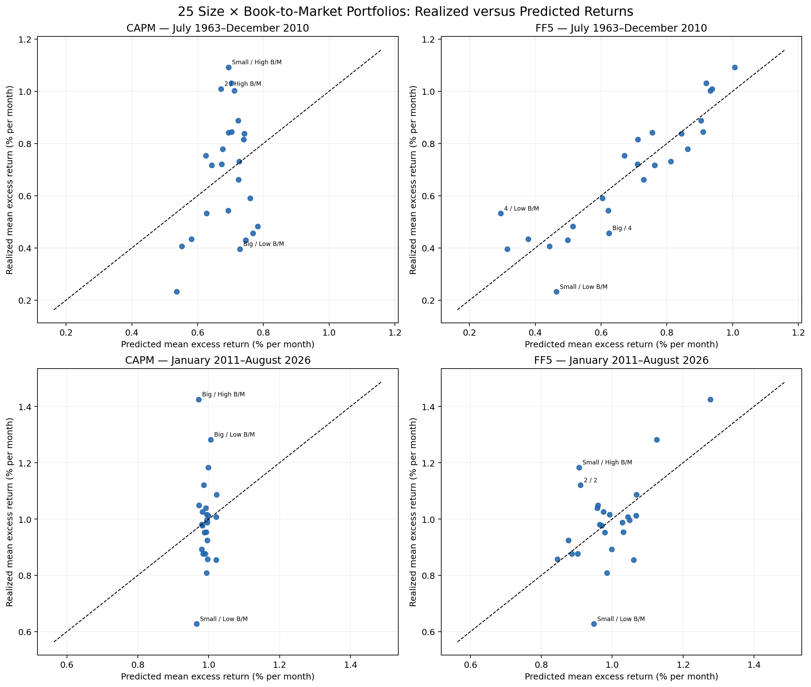
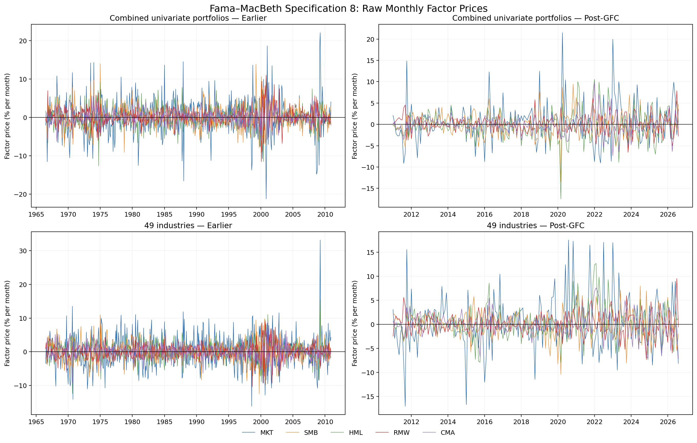
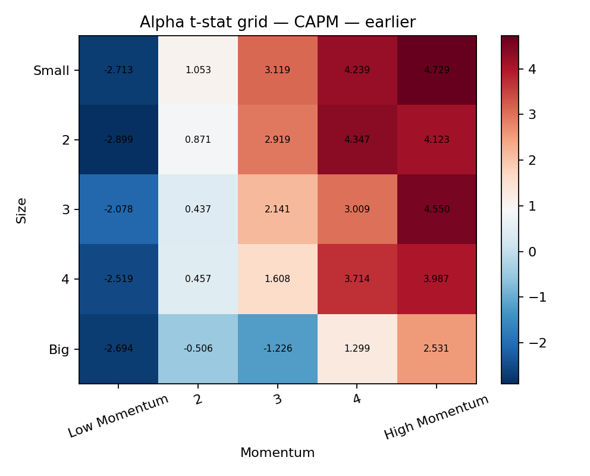
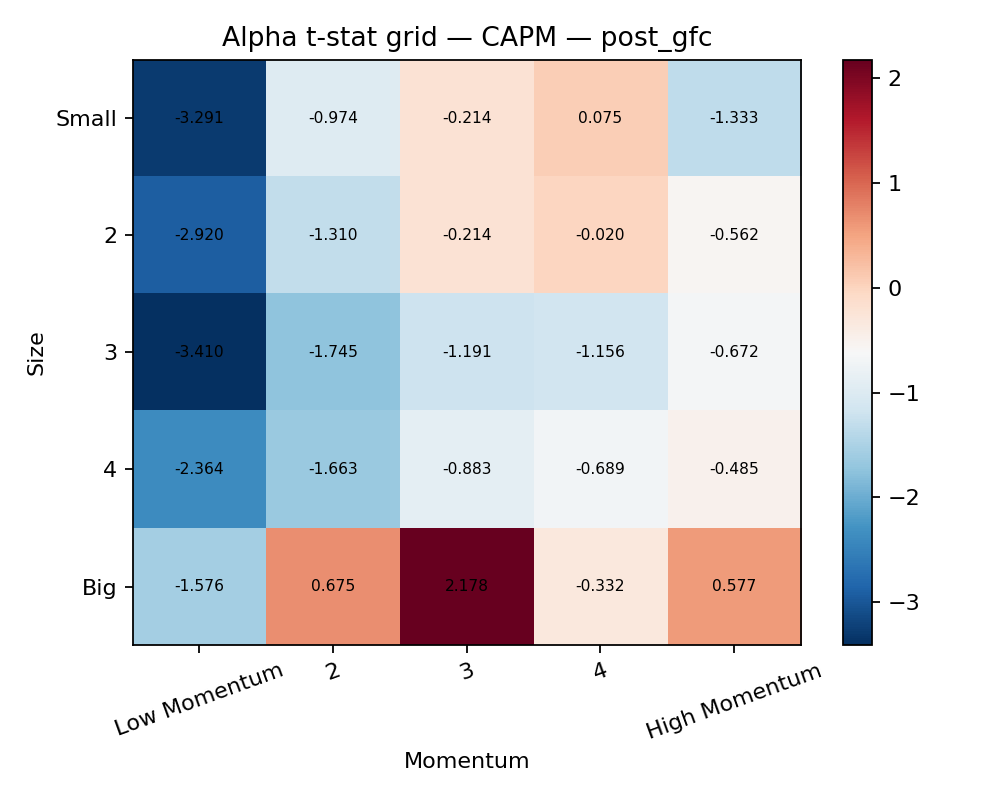

# Assignment 3 Canonical Final Report

> **Status.** This is the frozen canonical-production report. Every empirical claim is derived from the fresh canonical run. All returns, alphas, and lambdas shown in prose and tables are monthly percentage points; underlying CSV files remain in decimal-return units unless their column name explicitly ends in `_pct_month`.

## 1. Executive Summary

- **CAPM provides little long-run cross-sectional explanation for most 5×5 families.** Its mean cross-sectional R² is 0.093 in July 1963–December 2010 and 0.183 after 2010. For Size × Book-to-Market specifically, R² is only 0.078 earlier and 0.008 post-GFC; the latter is effectively zero despite economically large corner-portfolio errors.

- **FF3 and especially FF5 improve fit broadly, not just in a few families.** Both models raise R² relative to CAPM in all 11 families in each sample. Mean R² rises from 0.093 to 0.687 and 0.808 earlier, and from 0.183 to 0.381 and 0.508 post-GFC. Mean absolute pricing error falls from 0.190% to 0.080% per month earlier, but only from 0.118% to 0.098% post-GFC.

- **The incremental HML evidence inside FF5 is strongly test-asset and period dependent.** Earlier, HML is positive in 8/11 families and conventionally significant in 3/11; its median incremental R² is 0.018. Post-GFC it is positive in only 4/11 and significant in 1/11, although some families still obtain substantial incremental fit. That pattern does not support a universal redundancy claim.

- **Fama–MacBeth prices are much less precise than the full-sample two-pass fits might suggest.** In specification 8, the earlier combined-univariate RMW price is 0.181% per month (FM t = 2.01), while the earlier industry HML price is 0.238% (t = 1.98). None of the five post-GFC factor prices has |t| near 1.96 in either universe. The result depends on the cross-sectional beta variation supplied by the test assets.

- **Estimated monthly factor prices are extremely noisy and frequently change sign.** Specification-8 MKT lambda standard deviations range from 4.57% to 5.44% per month across the four universe/sample panels, versus means between 0.002% and 0.426%. Positive shares are generally close to one half. Extreme months are reported without assigning causal stories.

- **The selected time-series universe is Size × Momentum.** In the earlier sample, CAPM leaves a pronounced low-to-high momentum alpha pattern, and GRS rejects every model at p < 1.4×10⁻¹⁰. Post-GFC evidence is borderline and model dependent: CAPM p = 0.0637, FF3 p = 0.0489, and FF5 p = 0.0565.

- **The three frameworks answer different questions.** FF5 can deliver high cross-sectional R² while still failing the earlier GRS joint-alpha restriction, and volatile monthly lambdas can make FM average prices imprecise even where full-period beta sorts fit average returns well.

*Sources: [cross-family fit](../tables/cross_family_fit.csv), [FM summary](../tables/fama_macbeth_summary.csv), [lambda diagnostics](../tables/lambda_time_variation.csv), and [GRS results](../tables/grs_results.csv).*

## 2. Data, Models, and Samples

The test assets are eleven value-weighted 25-portfolio Size × Characteristic families, a combined set of 80 univariate characteristic portfolios, and 49 value-weighted industries. CAPM uses MKT; FF3 uses MKT, SMB, and HML; FF5 adds RMW and CMA. MKT is already the market excess return. Every asset return is converted from percent to decimal once and then reduced by RF once in the processed-data layer.

The headline earlier sample is July 1963–December 2010 (570 months); the post-GFC sample is January 2011–August 2026 (188 months), the audited latest common endpoint. FM betas require 36 complete months, so the earlier second-stage return sample is July 1966–December 2010 (534 months). The post-GFC FM sample begins in January 2011 because the December 2010 beta legitimately uses January 2008–December 2010 history.

## 3. Two-Pass Cross-Sectional Asset-Pricing Evidence

### 3.1 Representative Size × Book-to-Market comparison

**Figure 1.** Realized and predicted mean monthly excess returns for the 25 Size × Book-to-Market portfolios. Labels identify the three largest absolute pricing errors in each panel. The dashed line is the 45-degree benchmark. Source data: [pricing errors](../results/two_pass/pricing_errors.csv).

Earlier, CAPM R² is 0.078, mean absolute pricing error is 0.187% per month, and the largest error is 0.398%. The model underpredicts Small/High B/M by 0.398% and Size-2/High B/M by 0.338%, while overpredicting Big/Low B/M by 0.333%. The signs therefore trace a value-like spread, with meaningful errors at both small-value and big-growth corners.

FF5 moves the earlier points substantially toward the diagonal: R² reaches 0.811 and mean absolute error falls to 0.080%. The largest residuals remain economically structured—Size-4/Low B/M is underpredicted by 0.238% and Small/Low B/M is overpredicted by 0.232%—so high fit is not the same as zero pricing error.

Post-GFC CAPM R² falls to 0.008. Big/High B/M is underpredicted by 0.453%, Small/Low B/M is overpredicted by 0.339%, and Big/Low B/M is underpredicted by 0.276%. FF5 raises R² to 0.336 and lowers the maximum absolute error to 0.321%, but its mean absolute error (0.091%) is only modestly below CAPM (0.105%). The post-GFC cloud is therefore better organized by FF5 without becoming tightly aligned with the diagonal.

**Table 1. Size × B/M model comparison.** Errors are percentage points per month.

| Sample | CAPM R² | FF3 R² | FF5 R² | CAPM MAE | FF5 MAE | CAPM max \|e\| | FF5 max \|e\| |
|---|---|---|---|---|---|---|---|
| Earlier | 0.078 | 0.753 | 0.811 | 0.187% | 0.080% | 0.398% | 0.238% |
| Post-GFC | 0.008 | 0.299 | 0.336 | 0.105% | 0.091% | 0.453% | 0.321% |

### 3.2 Evidence across all eleven families

**Table 2. Cross-sectional fit and pricing errors across 5×5 families.** MAE is mean absolute pricing error in percentage points per month.

| Family | Sample | CAPM R² | FF3 R² | FF5 R² | ΔR² FF3 | ΔR² FF5 | CAPM MAE | FF5 MAE |
|---|---|---|---|---|---|---|---|---|
| Accruals | Earlier | 0.164 | 0.605 | 0.739 | +0.441 | +0.575 | 0.129 | 0.072 |
| Accruals | Post-GFC | 0.273 | 0.363 | 0.430 | +0.090 | +0.157 | 0.105 | 0.093 |
| Book-to-Market | Earlier | 0.078 | 0.753 | 0.811 | +0.675 | +0.733 | 0.187 | 0.080 |
| Book-to-Market | Post-GFC | 0.008 | 0.299 | 0.336 | +0.290 | +0.327 | 0.105 | 0.091 |
| Investment | Earlier | 0.040 | 0.741 | 0.742 | +0.701 | +0.702 | 0.172 | 0.070 |
| Investment | Post-GFC | 0.026 | 0.367 | 0.382 | +0.341 | +0.356 | 0.077 | 0.074 |
| Long-Term Reversal | Earlier | 0.032 | 0.757 | 0.807 | +0.725 | +0.775 | 0.161 | 0.066 |
| Long-Term Reversal | Post-GFC | 0.038 | 0.269 | 0.416 | +0.230 | +0.377 | 0.100 | 0.079 |
| Market Beta | Earlier | 0.020 | 0.856 | 0.860 | +0.836 | +0.840 | 0.127 | 0.047 |
| Market Beta | Post-GFC | 0.181 | 0.546 | 0.612 | +0.365 | +0.431 | 0.138 | 0.110 |
| Momentum | Earlier | 0.079 | 0.759 | 0.877 | +0.680 | +0.798 | 0.271 | 0.091 |
| Momentum | Post-GFC | 0.514 | 0.519 | 0.550 | +0.005 | +0.036 | 0.108 | 0.103 |
| Net Share Issues | Earlier | 0.001 | 0.559 | 0.661 | +0.557 | +0.660 | 0.215 | 0.115 |
| Net Share Issues | Post-GFC | 0.007 | 0.137 | 0.363 | +0.130 | +0.356 | 0.174 | 0.146 |
| Operating Profitability | Earlier | 0.031 | 0.592 | 0.910 | +0.561 | +0.879 | 0.160 | 0.043 |
| Operating Profitability | Post-GFC | 0.244 | 0.255 | 0.489 | +0.010 | +0.244 | 0.083 | 0.080 |
| Residual Variance | Earlier | 0.142 | 0.571 | 0.828 | +0.428 | +0.685 | 0.248 | 0.106 |
| Residual Variance | Post-GFC | 0.379 | 0.528 | 0.730 | +0.149 | +0.351 | 0.131 | 0.098 |
| Short-Term Reversal | Earlier | 0.324 | 0.835 | 0.865 | +0.511 | +0.541 | 0.186 | 0.079 |
| Short-Term Reversal | Post-GFC | 0.178 | 0.498 | 0.540 | +0.320 | +0.362 | 0.132 | 0.096 |
| Variance | Earlier | 0.112 | 0.529 | 0.792 | +0.417 | +0.681 | 0.237 | 0.105 |
| Variance | Post-GFC | 0.162 | 0.408 | 0.744 | +0.246 | +0.582 | 0.143 | 0.108 |

The improvement is broad: FF5 raises R² for every family in both samples. Earlier gains are especially large for Operating Profitability (+0.879), Market Beta (+0.840), Momentum (+0.798), and Long-Term Reversal (+0.775). Post-GFC gains are smaller and more heterogeneous: only +0.036 for Momentum, versus +0.582 for Variance. Thus the factors' incremental cross-sectional content is much weaker for post-GFC momentum portfolios but remains substantial for variance-related sorts.

The largest CAPM error across all earlier families is Small/High Momentum at +0.796% per month; Small/High Short-Term Reversal, Small/High Variance, and Small/High Residual Variance have errors from −0.671% to −0.697%. Post-GFC the largest is Small/High Variance at −0.797%, followed by Big/portfolio-3 Net Share Issues at +0.660% and Small/High Residual Variance at −0.642%. CAPM failures cluster in extreme characteristic cells, often among small firms, but are not exclusively small-stock phenomena.

### 3.3 HML inside FF5

The reduced cross section uses MKT, SMB, RMW, and CMA betas taken from the full FF5 first pass; the full cross section adds HML. Earlier Size × B/M is the clearest positive case: HML is 0.380% per month (t = 6.26) and adds 0.389 to R². Earlier Momentum is the clearest negative case: −0.872% (t = −4.58), adding 0.135. Market Beta is also positive and significant at 0.625% (t = 2.26). These opposite signs show that the HML price depends on which beta cross section identifies it.

Post-GFC, only Long-Term Reversal is conventionally significant: −0.254% (t = −2.13), with ΔR² = 0.140. Size × B/M itself has essentially no incremental HML evidence in this period—0.006% (t = 0.08), ΔR² = 0.0002—while Momentum and Short-Term Reversal obtain positive but imprecise HML prices. HML is therefore neither uniformly indispensable nor uniformly redundant.

The full family-level diagnostic appears in Appendix Table A1 and [the machine-readable HML table](../tables/hml_diagnostics.csv).

## 4. Fama–MacBeth Evidence

### 4.1 Eight specifications

Each cell below is the mean monthly lambda in percentage points followed by the conventional FM t-statistic in parentheses. HAC estimates use six lags and are available in the linked structured table.

**Table 3A. Combined univariate portfolios — Earlier.**

| Spec. | Intercept | MKT | SMB | HML | RMW | CMA |
|---|---|---|---|---|---|---|
| 1 | 0.543 (2.69) | -0.067 (-0.28) | — | — | — | — |
| 2 | 0.520 (2.79) | -0.072 (-0.35) | 0.061 (0.47) | 0.179 (1.50) | — | — |
| 3 | 0.383 (1.83) | 0.087 (0.44) | 0.023 (0.17) | — | 0.156 (1.75) | — |
| 4 | 0.584 (2.93) | -0.103 (-0.50) | 0.135 (1.08) | — | — | 0.080 (1.03) |
| 5 | 0.410 (2.02) | 0.041 (0.21) | -0.023 (-0.17) | 0.087 (0.83) | 0.222 (2.18) | — |
| 6 | 0.493 (2.57) | -0.032 (-0.15) | 0.094 (0.75) | 0.195 (1.80) | — | 0.139 (1.60) |
| 7 | 0.586 (2.95) | -0.110 (-0.55) | 0.084 (0.66) | — | 0.162 (2.11) | 0.050 (0.68) |
| 8 | 0.513 (2.73) | -0.061 (-0.30) | 0.035 (0.28) | 0.167 (1.41) | 0.181 (2.01) | 0.098 (1.16) |

**Table 3B. Combined univariate portfolios — Post-GFC.**

| Spec. | Intercept | MKT | SMB | HML | RMW | CMA |
|---|---|---|---|---|---|---|
| 1 | 0.874 (2.53) | 0.178 (0.44) | — | — | — | — |
| 2 | 0.614 (1.86) | 0.450 (1.27) | -0.169 (-0.79) | -0.225 (-0.87) | — | — |
| 3 | 0.755 (1.89) | 0.313 (0.73) | -0.147 (-0.64) | — | -0.053 (-0.33) | — |
| 4 | 0.706 (1.89) | 0.367 (0.88) | -0.089 (-0.40) | — | — | -0.116 (-0.96) |
| 5 | 0.602 (1.72) | 0.458 (1.26) | -0.254 (-1.18) | -0.080 (-0.36) | 0.011 (0.07) | — |
| 6 | 0.691 (2.17) | 0.375 (1.06) | -0.167 (-0.83) | -0.180 (-0.70) | — | -0.118 (-0.75) |
| 7 | 0.749 (1.98) | 0.324 (0.80) | -0.071 (-0.31) | — | -0.050 (-0.31) | -0.094 (-0.81) |
| 8 | 0.640 (1.96) | 0.426 (1.28) | -0.207 (-1.00) | -0.148 (-0.58) | 0.051 (0.35) | -0.097 (-0.62) |

**Table 4A. 49 industries — Earlier.**

| Spec. | Intercept | MKT | SMB | HML | RMW | CMA |
|---|---|---|---|---|---|---|
| 1 | 0.547 (2.73) | 0.003 (0.01) | — | — | — | — |
| 2 | 0.496 (2.66) | -0.004 (-0.02) | -0.002 (-0.02) | 0.254 (2.08) | — | — |
| 3 | 0.577 (3.01) | -0.038 (-0.20) | -0.067 (-0.55) | — | 0.113 (1.45) | — |
| 4 | 0.512 (2.91) | 0.010 (0.05) | 0.040 (0.34) | — | — | 0.084 (1.14) |
| 5 | 0.506 (2.67) | 0.003 (0.02) | -0.132 (-1.01) | 0.145 (1.52) | 0.164 (1.76) | — |
| 6 | 0.511 (2.90) | 0.005 (0.02) | 0.012 (0.10) | 0.190 (1.86) | — | 0.147 (1.70) |
| 7 | 0.535 (2.98) | -0.002 (-0.01) | -0.031 (-0.26) | — | 0.074 (0.98) | 0.070 (0.97) |
| 8 | 0.490 (2.74) | 0.002 (0.01) | -0.057 (-0.45) | 0.238 (1.98) | 0.068 (0.72) | 0.157 (1.71) |

**Table 4B. 49 industries — Post-GFC.**

| Spec. | Intercept | MKT | SMB | HML | RMW | CMA |
|---|---|---|---|---|---|---|
| 1 | 0.786 (2.34) | 0.169 (0.43) | — | — | — | — |
| 2 | 0.669 (1.80) | 0.271 (0.67) | 0.013 (0.07) | 0.121 (0.48) | — | — |
| 3 | 0.820 (2.07) | 0.162 (0.39) | -0.007 (-0.03) | — | 0.106 (0.63) | — |
| 4 | 0.940 (2.49) | 0.095 (0.24) | 0.027 (0.14) | — | — | -0.037 (-0.25) |
| 5 | 0.733 (1.88) | 0.211 (0.51) | -0.035 (-0.17) | 0.254 (1.27) | 0.138 (0.85) | — |
| 6 | 0.808 (2.25) | 0.184 (0.48) | 0.047 (0.25) | 0.263 (1.07) | — | 0.022 (0.12) |
| 7 | 0.913 (2.30) | 0.116 (0.28) | -0.007 (-0.03) | — | 0.094 (0.56) | -0.037 (-0.26) |
| 8 | 0.735 (1.98) | 0.254 (0.64) | -0.006 (-0.03) | 0.238 (0.96) | 0.135 (0.84) | 0.005 (0.03) |

Earlier combined-univariate results attach the most stable positive price to RMW: it is 0.218% (t = 2.18) in specification 5, 0.161% (t = 2.11) in specification 7, and 0.181% (t = 2.01) in specification 8. HML is positive but less precise in the full specification (0.167%, t = 1.41). For industries, HML is more prominent: 0.247% (t = 2.08) in FF3/specification 2 and 0.238% (t = 1.98) in specification 8. The full-specification MKT and SMB prices are near zero for industries.

Post-GFC factor-price precision deteriorates in both universes. In combined univariate portfolios, specification-8 MKT is 0.426% (t = 1.28), while SMB, HML, and CMA are negative but insignificant. In industries, HML remains positive at 0.238% but has t = 0.96; the other four prices are also imprecise. Intercepts, however, are often positive and statistically detectable, which cautions against interpreting weak factor prices as successful conditional pricing.

### 4.2 Historical premia and economic signs

**Table 5. Historical factor means over the headline samples.**

| Factor | Sample | Mean return | t-stat |
|---|---|---|---|
| MKT | Earlier | 0.448% | 2.36 |
| SMB | Earlier | 0.294% | 2.26 |
| HML | Earlier | 0.402% | 3.36 |
| RMW | Earlier | 0.276% | 2.88 |
| CMA | Earlier | 0.331% | 3.88 |
| MKT | Post-GFC | 1.069% | 3.48 |
| SMB | Post-GFC | -0.140% | -0.71 |
| HML | Post-GFC | -0.032% | -0.13 |
| RMW | Post-GFC | 0.177% | 1.06 |
| CMA | Post-GFC | -0.023% | -0.15 |

In the earlier period all five historical factor means are positive. Specification-8 FM signs broadly agree for SMB, HML, RMW, and CMA in the combined-univariate cross section, but MKT is slightly negative; industries produce positive HML/RMW/CMA but near-zero MKT and negative SMB. Post-GFC historical SMB, HML, and CMA means are negative. The combined-univariate FM prices share those signs, whereas industry HML is positive and industry SMB/CMA are approximately zero. These discrepancies are economically plausible because FM lambdas price cross-sectional beta variation and need not reproduce the factor portfolios' time-series means.

### 4.3 Monthly lambda variation

**Figure 2.** Raw monthly specification-8 factor prices for both universes and samples. No smoothing is applied. Source: [monthly lambdas](../results/fama_macbeth/monthly_lambdas/all.csv).

MKT is the most volatile factor price in every panel: its standard deviation is 4.71% earlier and 4.57% post-GFC for combined univariate portfolios, and 4.84% and 5.44% for industries. Its sign is positive in only 47.2%, 53.7%, 48.5%, and 48.4% of months, respectively. The largest positive MKT estimates are 22.06% (April 2009) and 21.48% (April 2020) for combined portfolios, and 33.15% (April 2009) and 17.55% (August 2020) for industries.

HML also changes sign frequently. For combined portfolios its positive share drops from 50.9% earlier to 43.1% post-GFC; the post-GFC range is −17.48% in March 2020 to +10.54% in January 2022. Industry HML remains positive in about half the months. RMW and CMA are less volatile than MKT, but their standard deviations still exceed 1.95% per month in every panel—far larger than their average prices.

## 5. Time-Series Alpha and GRS Evidence

The audited GRS family is **Size × Momentum**. Rows are Size buckets and columns run from Low to High Momentum.

**Figure 3A.** CAPM alpha t-statistics, July 1963–December 2010.

**Figure 3B.** CAPM alpha t-statistics, January 2011–August 2026.

Earlier CAPM alphas display a strong monotonic momentum pattern within the smaller size rows: Low Momentum t-statistics are negative, while columns 4 and 5 are broadly positive. Small/High Momentum has alpha 0.822% per month (t = 4.73); the most negative CAPM t-stat is Size-2/Low Momentum, −0.563% (t = −2.90). Seventeen of 25 CAPM alphas have individual p-values below 5%.

After 2010 the grid is less monotonic and generally less individually significant. The strongest negative is Size-3/Low Momentum at −1.076% (t = −3.41); the strongest positive t-stat belongs to Big/portfolio-3 at 0.225% (t = 2.18). Five CAPM alphas are individually significant.

Adding factors reduces mean absolute alpha from 0.346% under CAPM to 0.331% under FF3 and 0.294% under FF5 earlier, but it does not remove the small-stock momentum spread: under FF5, Small/High Momentum is +0.645% (t = 6.38) and Small/Low Momentum is −0.751% (t = −4.55). Post-GFC, mean absolute alpha falls from 0.314% to 0.224% under FF3 and 0.231% under FF5, while Size-3/Low Momentum remains near −0.74% with t around −3.0.

**Table 6. Portfolio-alpha summary.**

| Sample | Model | Mean \|alpha\| | Max \|alpha\| | Mean \|t\| | p < 5% |
|---|---|---|---|---|---|
| Earlier | CAPM | 0.346% | 0.822% | 2.55 | 17/25 |
| Earlier | FF3 | 0.331% | 0.998% | 2.99 | 17/25 |
| Earlier | FF5 | 0.294% | 0.751% | 2.76 | 19/25 |
| Post-GFC | CAPM | 0.314% | 1.221% | 1.22 | 5/25 |
| Post-GFC | FF3 | 0.224% | 0.739% | 1.35 | 7/25 |
| Post-GFC | FF5 | 0.231% | 0.747% | 1.41 | 7/25 |

**Table 7. GRS joint-alpha tests.**

| Sample | Model | GRS F | df1 | df2 | p-value | 5% decision |
|---|---|---|---|---|---|---|
| Earlier | CAPM | 4.655 | 25 | 544 | 3.141e-12 | Reject |
| Earlier | FF3 | 4.647 | 25 | 542 | 3.387e-12 | Reject |
| Earlier | FF5 | 4.202 | 25 | 540 | 1.363e-10 | Reject |
| Post-GFC | CAPM | 1.523 | 25 | 162 | 0.06367 | Do not reject |
| Post-GFC | FF3 | 1.579 | 25 | 160 | 0.04894 | Reject |
| Post-GFC | FF5 | 1.550 | 25 | 158 | 0.05648 | Do not reject |

The earlier individual and joint evidence agree that all three models leave systematic momentum-related returns. Post-GFC they give a more nuanced picture: several individual alphas remain significant, yet the joint tests are near the 5% boundary. FF3 rejects at 4.89%, while CAPM and FF5 do not at 6.37% and 5.65%. Residual covariance and the full alpha vector, not a count of individual t-tests, determine GRS.

## 6. Integrated Interpretation Across the Three Testing Frameworks

| Framework | Main object | Economic question |
|---|---|---|
| Two-pass | Lambda from average-return cross section | Are long-run average returns related to full-sample factor betas? |
| Fama–MacBeth | Monthly predictive lambda_t | Do exposures estimated through t predict returns at t+1? |
| Time-series / GRS | Portfolio alpha_i | Does the model leave systematic unexplained returns? |

The empirical results are not contradictory. FF5's mean two-pass R² of 0.808 earlier says its beta pattern spans much of the variation in average returns across each 25-asset family. It does not imply that all time-series intercepts are zero: on Size × Momentum, earlier GRS still rejects FF5 decisively. Similarly, the weak average FM t-statistics reflect large month-to-month lambda variation and beta-estimation noise; they do not undo the descriptive full-sample cross-sectional fit. Finally, adding a factor can improve time-series or cross-sectional fit without producing a precisely estimated price for that factor in every asset universe.

## 7. Answers to Analysis and Interpretation Questions

### 1. Does the CAPM price the cross section of the 5×5 portfolios? Where are its largest systematic pricing errors?

Generally, no. CAPM mean R² across the eleven families is 0.093 earlier and 0.183 post-GFC. Size × B/M R² is 0.078 and 0.008; across families, CAPM R² ranges from 0.001 for earlier Net Share Issues to 0.324 for earlier Short-Term Reversal, and from 0.007 for post-GFC Net Share Issues to 0.514 for post-GFC Momentum.

The largest earlier error is Small/High Momentum (+0.796% per month). Extreme Small/High Short-Term Reversal, Variance, and Residual Variance portfolios have errors near −0.67% to −0.70%. Post-GFC, Small/High Variance is −0.797%, Big/portfolio-3 Net Share Issues is +0.660%, and Small/High Residual Variance is −0.642%. In Size × B/M, errors appear at both value and growth corners rather than in one size bucket alone.

### 2. How much do FF3 and FF5 improve cross-sectional pricing, and is improvement consistent?

Earlier, mean R² rises from 0.093 under CAPM to 0.687 under FF3 and 0.808 under FF5; mean absolute error falls from 0.190% to 0.102% and 0.080%. Post-GFC, mean R² rises from 0.183 to 0.381 and 0.508, while mean absolute errors fall more modestly from 0.118% to 0.107% and 0.098%.

R² improves in all eleven families in both samples, but magnitudes differ sharply. Earlier FF5 gains range from +0.541 for Short-Term Reversal to +0.879 for Profitability; post-GFC gains range from only +0.036 for Momentum to +0.582 for Variance. The improvement is broad but not uniform, and post-GFC error reductions are much less dramatic than R² comparisons alone suggest.

### 3. Does HML retain an independent price in FF5?

Earlier, the median family HML price is 0.241% per month and the median ΔR² is 0.018; 3 of 11 prices are significant at 5%. Size × B/M is strongly positive, Momentum strongly negative, and Market Beta positive. This is evidence that HML can add information, but its price is not invariant to the test assets.

Post-GFC, the median price is -0.126%, only one family is significant, and signs are positive in 4 of 11 families. Long-Term Reversal has a significant negative HML price and the largest ΔR², while Size × B/M has virtually zero incremental fit. The appropriate conclusion is sample- and asset-dependent identification—not blanket redundancy or universal pricing.

### 4. How do factor prices differ between 1963–2010 and the post-GFC period?

In the two-pass FF5 cross sections, median prices across families shift from MKT 0.119%, SMB 0.298%, HML 0.241%, RMW 0.238%, and CMA 0.278% earlier to MKT 0.153%, SMB -0.144%, HML -0.126%, RMW 0.031%, and CMA 0.090% post-GFC. SMB and HML notably change from positive to negative medians.

In predictive FM specification 8, combined-univariate MKT moves from −0.061% to +0.426%, while SMB/HML/CMA move from positive to negative; RMW remains positive but shrinks. Industries differ: HML remains about +0.238% in both samples, while MKT rises from essentially zero to +0.254%. None of the post-GFC factor prices is precisely estimated.

### 5. Are FM factor-price signs economically sensible relative to historical premia?

Earlier historical means are positive for all five factors. Combined-univariate specification-8 signs match for SMB, HML, RMW, and CMA, but not MKT; industries match for HML, RMW, and CMA, with near-zero MKT and negative SMB. Post-GFC historical SMB, HML, and CMA premia are negative, matching combined-univariate FM signs. Industry HML is instead positive, and industry SMB/CMA are nearly zero.

The partial sign agreement is economically sensible but not mechanical validation. Factor returns are payoffs to particular long-short portfolios; FM lambdas are prices inferred from the beta dispersion of a chosen test-asset cross section. Weak beta dispersion, sampling noise, and model misspecification can separate the two.

### 6. Are FM conclusions sensitive to characteristic portfolios versus industries?

Yes. Earlier, combined portfolios emphasize RMW (0.181%, t = 2.01 in specification 8), whereas industries emphasize HML (0.238%, t = 1.98). Earlier industry MKT and SMB prices are virtually zero, while combined portfolios provide somewhat more positive SMB/RMW structure. Post-GFC, combined HML is negative (−0.148%, t = −0.58), but industry HML is positive (+0.238%, t = 0.96).

Characteristic sorts are constructed to spread firm attributes and often generate stronger dispersion in corresponding factor betas and expected returns. Industries instead vary by economic activity and may span factor exposures differently. The coefficients therefore answer asset-universe-specific cross-sectional questions; neither universe alone supplies a universal price vector.

### 7. How volatile are specification-8 monthly factor prices?

Very volatile. MKT lambda standard deviations are 4.57%–5.44% per month, with signs close to evenly split. HML standard deviations are 2.74%–3.51%; RMW and CMA are lower but still about 1.95%–2.43%. These dispersions dwarf the corresponding mean lambdas.

Notable computed extremes include combined-univariate MKT +22.06% in April 2009 and −21.25% in November 2000; post-GFC combined HML reaches −17.48% in March 2020 and +10.54% in January 2022. Industry MKT reaches +33.15% in April 2009 and post-GFC ranges from −17.04% in September 2011 to +17.55% in August 2020. The report does not assign causal event explanations to these dates.

### 8. What are the limitations of a fixed 36-month rolling-beta window?

Thirty-six observations produce noisy multivariate beta estimates, especially for FF5, creating an errors-in-variables problem in the second-stage cross sections. A longer window would reduce variance but increase bias when exposures change; a shorter window would adapt faster but amplify estimation noise. The method assumes exposures are locally stable inside each window and cannot react instantly to structural breaks or a single abrupt regime change.

Adjacent windows share 35 of 36 observations, making estimated betas highly serially dependent. Extreme returns can influence many successive windows. Requiring complete observations can also change the available cross section when data are missing. The audited t−35 through t → t+1 alignment prevents look-ahead bias, but it does not remove beta noise, overlap-induced dependence, sensitivity to outliers, or attenuation and instability in estimated factor prices.

### 9. Do individual alpha tests and GRS tell the same story?

Earlier they broadly agree: many momentum-portfolio alphas are individually significant—17 under CAPM, 17 under FF3, and 19 under FF5—and GRS rejects all three models with p-values below 1.4×10⁻¹⁰. FF5 lowers mean absolute alpha but leaves an especially strong Small Low-to-High Momentum contrast, so improved fit does not satisfy the zero-alpha restriction.

Post-GFC the impressions differ. Individual significant-alpha counts are 5, 7, and 7, yet GRS p-values are 0.0637, 0.0489, and 0.0565 for CAPM, FF3, and FF5. GRS jointly weights the full alpha vector by residual covariance; several modest correlated alphas may reject, while one large t-statistic need not. The borderline post-GFC decisions should not be presented as a stable ranking of models.

## 8. Methodological Limitations

Beyond rolling-beta limitations, the two-pass estimates treat first-pass betas as regressors without a Shanken-style errors-in-variables correction. The eleven families are related rather than independent experiments, so family-level significance counts do not correct for multiple testing. Cross-sectional R² can rise mechanically with additional regressors and does not establish zero alphas. FM results depend on test-asset beta dispersion and use conventional time-series inference as the primary assignment result; six-lag HAC estimates are a robustness diagnostic, not a cure for all dependence. GRS assumes stable linear factor structure, invertible covariance matrices, and the selected 25-asset universe. Finally, Kenneth French histories can be revised, so the source hashes and August 2026 endpoint are part of the result definition.

## 9. Concluding Takeaways

CAPM does not organize the eleven 5×5 average-return cross sections well, and its largest errors concentrate in economically extreme characteristic cells. FF3 and FF5 improve cross-sectional fit across every family, with FF5 strongest in the earlier sample, but post-GFC gains are smaller and residual error patterns remain.

HML's incremental role is conditional: it is powerful for some earlier cross sections, irrelevant for post-GFC Size × B/M, and negative for other families. FM evidence is likewise universe dependent and generally imprecise because monthly factor prices are highly volatile. Time-series evidence for Size × Momentum remains the most demanding: all three models fail the earlier joint-alpha test, while post-GFC GRS results sit near the conventional threshold. Taken together, the models describe important dimensions of average returns without delivering a single, stable, universally validated price system.

## Appendix: Supporting Tables and Figures

### Appendix Table A1. HML incremental diagnostic by family

| Family | Sample | HML price | t | p | ΔR² |
|---|---|---|---|---|---|
| Book-to-Market | Earlier | 0.380% | 6.26 | 0.000 | +0.389 |
| Book-to-Market | Post-GFC | 0.006% | 0.08 | 0.941 | +0.000 |
| Operating Profitability | Earlier | 0.241% | 1.92 | 0.070 | +0.018 |
| Operating Profitability | Post-GFC | -0.061% | -0.40 | 0.692 | +0.004 |
| Investment | Earlier | 0.568% | 1.54 | 0.141 | +0.032 |
| Investment | Post-GFC | 0.151% | 0.79 | 0.440 | +0.020 |
| Momentum | Earlier | -0.872% | -4.58 | 0.000 | +0.135 |
| Momentum | Post-GFC | 0.416% | 0.87 | 0.397 | +0.018 |
| Short-Term Reversal | Earlier | 1.032% | 2.05 | 0.055 | +0.030 |
| Short-Term Reversal | Post-GFC | 0.819% | 1.55 | 0.138 | +0.058 |
| Long-Term Reversal | Earlier | 0.078% | 0.27 | 0.790 | +0.001 |
| Long-Term Reversal | Post-GFC | -0.254% | -2.13 | 0.046 | +0.140 |
| Accruals | Earlier | 0.404% | 1.11 | 0.280 | +0.017 |
| Accruals | Post-GFC | -0.126% | -0.37 | 0.716 | +0.004 |
| Market Beta | Earlier | 0.625% | 2.26 | 0.036 | +0.037 |
| Market Beta | Post-GFC | -0.695% | -1.59 | 0.128 | +0.052 |
| Net Share Issues | Earlier | 0.151% | 0.42 | 0.676 | +0.003 |
| Net Share Issues | Post-GFC | -0.172% | -0.54 | 0.599 | +0.010 |
| Variance | Earlier | -0.386% | -0.93 | 0.364 | +0.009 |
| Variance | Post-GFC | -0.916% | -1.72 | 0.101 | +0.040 |
| Residual Variance | Earlier | -0.552% | -1.33 | 0.198 | +0.016 |
| Residual Variance | Post-GFC | -1.345% | -1.68 | 0.109 | +0.040 |

### Appendix Table A2. Specification-8 lambda time-variation diagnostics

| Universe | Sample | Factor | Mean | Std. dev. | Share + | Minimum (month) | Maximum (month) |
|---|---|---|---|---|---|---|---|
| Combined univariate | Earlier | MKT | -0.061% | 4.706% | 47.2% | -21.25% (2000-11) | 22.06% (2009-04) |
| Combined univariate | Earlier | SMB | 0.035% | 2.923% | 49.6% | -9.10% (1978-10) | 14.00% (1975-01) |
| Combined univariate | Earlier | HML | 0.167% | 2.737% | 50.9% | -12.64% (1974-10) | 10.24% (2000-11) |
| Combined univariate | Earlier | RMW | 0.181% | 2.077% | 53.6% | -11.53% (2000-02) | 11.00% (2000-11) |
| Combined univariate | Earlier | CMA | 0.098% | 1.954% | 50.7% | -6.31% (1968-04) | 9.00% (2001-02) |
| Combined univariate | Post-GFC | MKT | 0.426% | 4.567% | 53.7% | -9.15% (2011-08) | 21.48% (2020-04) |
| Combined univariate | Post-GFC | SMB | -0.207% | 2.828% | 44.1% | -13.43% (2020-03) | 9.43% (2020-11) |
| Combined univariate | Post-GFC | HML | -0.148% | 3.512% | 43.1% | -17.48% (2020-03) | 10.54% (2022-01) |
| Combined univariate | Post-GFC | RMW | 0.051% | 2.029% | 47.9% | -6.56% (2023-11) | 7.88% (2026-07) |
| Combined univariate | Post-GFC | CMA | -0.097% | 2.143% | 44.1% | -7.37% (2023-01) | 9.91% (2022-01) |
| 49 industries | Earlier | MKT | 0.002% | 4.845% | 48.5% | -16.15% (1998-08) | 33.15% (2009-04) |
| 49 industries | Earlier | SMB | -0.057% | 2.919% | 47.8% | -12.52% (1999-10) | 10.98% (1975-01) |
| 49 industries | Earlier | HML | 0.238% | 2.783% | 53.2% | -12.36% (1970-09) | 15.41% (2009-04) |
| 49 industries | Earlier | RMW | 0.068% | 2.175% | 50.7% | -10.34% (1998-09) | 9.04% (2000-09) |
| 49 industries | Earlier | CMA | 0.157% | 2.121% | 54.9% | -9.24% (1970-09) | 9.19% (2001-02) |
| 49 industries | Post-GFC | MKT | 0.254% | 5.438% | 48.4% | -17.04% (2011-09) | 17.55% (2020-08) |
| 49 industries | Post-GFC | SMB | -0.006% | 2.850% | 53.2% | -10.43% (2020-03) | 7.98% (2024-07) |
| 49 industries | Post-GFC | HML | 0.238% | 3.394% | 51.1% | -7.94% (2020-03) | 12.68% (2022-02) |
| 49 industries | Post-GFC | RMW | 0.135% | 2.218% | 48.9% | -7.34% (2024-11) | 9.56% (2026-07) |
| 49 industries | Post-GFC | CMA | 0.005% | 2.426% | 48.4% | -7.18% (2026-08) | 7.59% (2022-02) |

### Artifact references

- Additional two-pass plots for all eleven families: [`results/figures/two_pass/`](../results/figures/two_pass/)
- Individual specification-8 lambda plots: [`results/figures/fama_macbeth/`](../results/figures/fama_macbeth/)
- Alpha and alpha-t grids for CAPM, FF3, and FF5: [`results/figures/time_series/`](../results/figures/time_series/)
- Full report-ready structured tables: [`tables/`](../tables/)
- Audited result inventory and source hashes: [`production_manifest.json`](../production_manifest.json)

The selected GRS family is `size_momentum`. Headline samples are July 1963–December 2010 and January 2011–August 2026; effective FM return samples are July 1966–December 2010 and January 2011–August 2026.